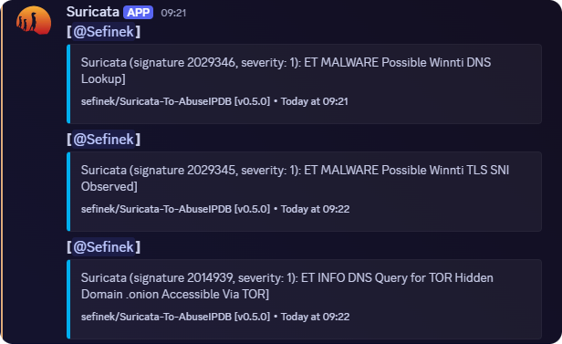

# 🛡️ Suricata AbuseIPDB Reporter
[](https://github.com/sefinek/Suricata-To-AbuseIPDB)
[](https://www.gnu.org/licenses/gpl-3.0)
[](https://nodejs.org)
[](https://github.com/sefinek/Suricata-To-AbuseIPDB/commits)
[](https://github.com/sefinek/Suricata-To-AbuseIPDB/stargazers)

An integration tool designed to analyze Suricata logs and report IP addresses to the [AbuseIPDB](https://www.abuseipdb.com) database.
To prevent excessive reporting of the same IP address within a short time period, the tool uses a temporary cache file to track previously reported IP addresses.

⭐ If you like this repository or find it useful, I'd greatly appreciate it if you could give it a star. Many thanks!  
☁️ Also, check this out: [sefinek/Suricata-To-AbuseIPDB](https://github.com/sefinek/Suricata-To-AbuseIPDB)

> [!IMPORTANT]
> - If you'd like to make changes to any files in this repository, please start by creating a [public fork](https://github.com/sefinek/Suricata-To-AbuseIPDB/fork).


## 📋 Requirements
- [Node.js + npm](https://gist.github.com/sefinek/fb50041a5f456321d58104bbf3f6e649)
- [PM2](https://www.npmjs.com/package/pm2) (`npm i -g pm2`)
- [Git](https://gist.github.com/sefinek/1de50073ffbbae82fc901506304f0ada)
- Linux (Ubuntu or Debian)


## ✅ Features
1. **Easy Configuration** - The [`config.js`](config.default.js) file allows for quick and simple configuration.
2. **Simple Installer** - Enables fast and seamless integration deployment.
3. **Self-IP Protection (IPv4 & IPv6)** - Addresses from Suricata's `HOME_NET` and the current IPs of your server are never reported.
4. **IP Filtering** - Local and special-purpose IP addresses will never be reported.
5. **IP Whitelist** - Maintain a `whitelist.txt` file with IP addresses that should never be reported (e.g., your home IP when running on a VPS). The file is watched for changes and reloaded automatically.
6. **Report Cooldown** - Prevents duplicate reports of the same IP within a configurable time window.
7. **Bulk Reporting Support** - If the script encounters a rate limit, it will start buffering collected IPs and send a bulk report.
8. **Discord Webhooks Integration**:
    - Critical notifications
    - Script error alerts
    - Daily summaries of reported IPs
9. **Update Notifications** - The script periodically checks for new versions and notifies you (also via Discord) when an update is available.


## 📥 Installation (Ubuntu & Debian)

### Install Node.js
See https://gist.github.com/sefinek/fb50041a5f456321d58104bbf3f6e649.

### Install Git
See https://gist.github.com/sefinek/1de50073ffbbae82fc901506304f0ada.

### Clone & Set up
```bash
sudo apt update && sudo apt upgrade
cd ~
git clone --recurse-submodules https://github.com/sefinek/Suricata-To-AbuseIPDB.git
cd Suricata-To-AbuseIPDB
npm install
cp config.default.js config.js
npm install -g pm2
pm2 start
eval "$(pm2 startup | grep sudo)"
pm2 save
```

### 🔍 Check Logs
```bash
pm2 logs suricata-abuseipdb
```


## ⚙️ What Gets Reported
Every alert with severity <= `MIN_ALERT_SEVERITY` is reported, unless its signature is ignored. The reported IP is always the external host that **opened the connection** to your network.

- Hosts contacted from your network (DNS resolvers, CDNs, P2P peers, game servers) are never reported, even if the alert was triggered by their reply.
- `HOME_NET` is read from `SURICATA_CONFIG_FILE` (`/etc/suricata/suricata.yaml` by default). The user running the script needs read access to it, e.g. by being a member of the `suricata` group: `sudo usermod -aG suricata $USER`. If the file cannot be read, `HOME_NET` from `config.js` is used as a fallback. If it is empty too, the script will not start.
- Ignored signatures: the built-in list ([`scripts/suricata/ignoredSignatures.js`](https://github.com/sefinek/IPDB-Integration-Scripts/blob/main/suricata/ignoredSignatures.js), can be disabled with `USE_BUILT_IN_IGNORED_SIGNATURES`) and your own `IGNORED_SIGNATURES`.
- The category is based on the alert classification: scans as Port Scan, web attacks as Web App Attack, DoS as DDoS Attack, everything else as Hacking.
- Set `EXTENDED_LOGS` to `true` to see why an alert was not reported.


### 📄 Example Reports & screenshots
```text
Suricata (signature 2100498, severity: 2): GPL ATTACK_RESPONSE id check returned root
```

```text
Suricata (signature 2029346, severity: 1): ET MALWARE Possible Winnti DNS Lookup
```

```text
Suricata (signature 2022048, severity: 1): ET MALWARE Cryptowall .onion Proxy Domain
```




## 🤝 Development
If you want to contribute to the development of this project, feel free to create a new [Pull request](https://github.com/sefinek/Suricata-To-AbuseIPDB/pulls). I will definitely appreciate it!


## 🔑 [GPL-3.0 License](LICENSE)
Copyright © 2024-2026 [Sefinek](https://sefinek.net)